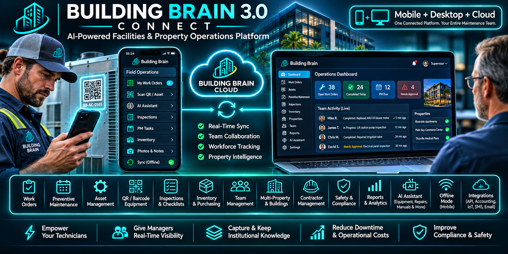
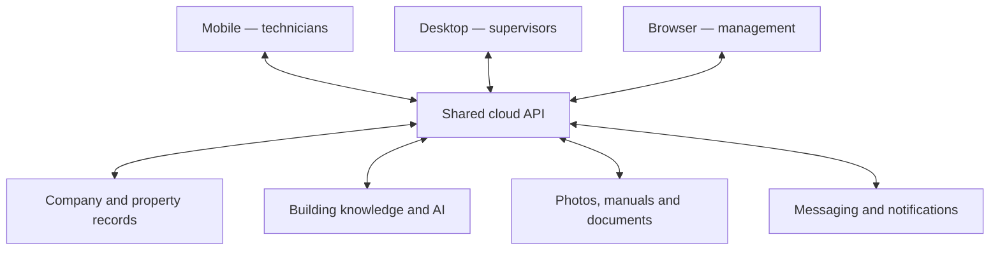

# Building Brain 3.0 — Connect

**AI-powered facilities and property operations platform.**

**One connected platform. Your entire maintenance team.**

Building Brain brings building intelligence, field maintenance, workforce coordination and management oversight together. The 3.0 vision connects technicians using Android and iOS devices with supervisors using Windows, Linux, macOS or the browser. Shared work orders, equipment records, conversations and approved repair knowledge follow the team across devices.

> **Development status:** Building Brain 2.0 is the current main-branch implementation. The 3.0 cover illustrates the intended product, not a released feature set. Native mobile and Connect API foundations exist in draft pull requests; full desktop, real-time collaboration, messaging, multi-tenant hosting and other roadmap features are not yet released or verified.

## The connected platform

| Application | Intended users | Purpose |
| --- | --- | --- |
| Building Brain Mobile | Technicians and contractors | Field work, QR scanning, photos, inspections, messaging and offline access |
| Building Brain Desktop | Supervisors, managers and owners | Dispatch, team oversight, inventory, budgets, approvals and reporting |
| Building Brain Web | Authorized staff | Browser access to the shared management workspace |
| Building Brain Cloud | Entire organization | Shared authentication, records, synchronization, notifications and secure storage |
| Building Brain AI | Technicians and management | Property-specific, source-grounded building intelligence |



This is the planned 3.0 architecture. The existing self-hosted application uses FastAPI, SQLite and a responsive web interface; the cloud services shown above are not yet a production deployment.

## Building Brain Connect — workforce coordination

The company creates a workspace and invites employees. Managers assign jobs to authorized technicians, who receive assignments on mobile, update their status, record labor and materials, attach evidence and submit completion reports. Management sees shared job history and reviews or reopens work when necessary.

Planned capabilities:

- Company workspaces, invitations, individual employee accounts and property/team assignments.
- Work order dispatch, reassignment, priority, due dates, escalation and supervisor approval.
- Live activity feeds, completion records, technician workload, labor hours and materials.
- Before-and-after photos, signatures, timestamps and searchable audit history.
- Shared building knowledge and repair history across authorized team members.
- Reliable real-time synchronization, with offline queuing and conflict handling for field devices.
- Optional property recognition using GPS; no continuous employee location tracking by default.

### Roles and permissions

| Role | Intended access |
| --- | --- |
| Owner / administrator | Company configuration, people, billing and all authorized properties |
| Regional / property manager | Assigned properties, budgets, reporting and operations |
| Maintenance supervisor | Assigned teams, dispatch, reviews and communications |
| Technician | Authorized properties, assigned work, equipment and knowledge |
| Contractor | Explicitly assigned work and necessary records |
| Resident / requester | Submit and track permitted maintenance requests |

Tenant isolation and role enforcement across every API, event, document and attachment are release requirements, not capabilities of the current single-admin main branch.

### Example connected workflow

1. A supervisor creates a work order on the desktop and assigns a technician.
2. The technician receives a mobile notification, opens the job and scans an equipment QR code.
3. Building Brain presents the relevant asset, approved procedures, repair history and manuals.
4. The technician messages the supervisor if clarification or a part is needed.
5. The technician records the repair, labor, parts and photos, then submits the job.
6. The supervisor sees the completion, reviews evidence and approves or reopens the job.
7. The verified repair becomes part of the building's long-term knowledge.

## Building Brain Messaging

Planned secure communications between employees and supervisors, available in both desktop and mobile clients:

- Direct, two-way messaging between supervisors and technicians.
- Property, department and maintenance-team group conversations.
- Work-order-specific threads, keeping instructions and updates attached to a job.
- Photo, document and manual sharing with authorized recipients.
- Push notifications, unread counts, read receipts and searchable message history.
- Company announcements and high-priority maintenance alerts.
- Offline retry, message delivery status, notification preferences and retention controls.

Messaging requires authenticated real-time delivery, organization and conversation membership checks, attachment authorization and security tests. Urgent messages are not a substitute for established emergency response channels. [Track messaging development (#10)](https://github.com/cuzzaintit321/building-brain/issues/10).

## Product modules and feature roadmap

| Module | Target functionality | Status |
| --- | --- | --- |
| AI building intelligence | Approved brand/model knowledge, manual retrieval, cited answers, asset-specific repair history, plan annotations | Core retrieval available; advanced features planned |
| Work orders | Create, prioritize, assign, track, complete, approve, escalate, labor and evidence | Core available; connected approvals and workforce features planned |
| Asset management | Equipment registry, location, model, serial, warranties, QR/barcodes, lifecycle history, meter readings, replacement planning | Core available; advanced features planned |
| Preventive maintenance | Recurring schedules, checklists, PM templates, meter triggers, seasonal maintenance | Core scheduling available; advanced features planned |
| Inspections | Custom forms, scheduled checklists, pass/fail results, evidence and corrective work orders | Planned |
| Inventory and purchasing | Parts catalog, stock movements, work-order parts usage, suppliers, purchase orders, receiving and reorder alerts | Planned |
| Property management | Multiple properties, GPS recognition, buildings, floors, rooms, floor plans | Properties and GPS available; expanded hierarchy planned |
| Workforce and messaging | Individual accounts, team dispatch, activity feed, conversations and notifications | Connect API draft; messaging planned |
| Contractor management | Vendor records, assignments, insurance, licenses and optional RiskLatch integration | Planned |
| Safety and compliance | Approved procedures, safety records, incident reports, permits and audit exports | Planned |
| Financial management | Labor and material costs, maintenance budgets, capital planning and expense reports | Planned |
| Native mobile | Android/iOS, QR scanning, camera, inspections, voice notes, signatures, offline sync | Separate prototype draft; integration and testing required |
| Desktop and reporting | Installable Windows/Linux/macOS client, KPIs, downtime, workload and scheduled reports | Responsive web interface available; native desktop and advanced reporting planned |
| Automation and integrations | Rules, reminders, escalation, API, webhooks, accounting, IoT, SMS/email and push | Planned |

## Building intelligence that stays with the property

Building Brain is designed to preserve institutional maintenance knowledge even when staff change. Each property builds an approved library of equipment brands and exact models, manufacturer manuals, plans, verified repairs, field notes and completed work-order resolutions.

A technician can select an asset and ask Brain for relevant source-grounded information. Answers should cite applicable records rather than invent repair instructions. This is retrieval-augmented knowledge, not training a separate AI model for every building. Safety-critical work requires verified procedures and qualified personnel.

## Technology and commercial architecture

| Layer | Current / planned technology |
| --- | --- |
| API | Python / FastAPI (canonical backend: `backend/main.py`) |
| Web interface | Existing responsive HTML/CSS/JavaScript and PWA |
| Mobile | React Native / Expo, Android and iOS (prototype) |
| Native desktop | Tauri, Windows/Linux/macOS (planned) |
| Database | SQLite currently; PostgreSQL for tenant-isolated SaaS (planned) |
| Realtime | Authenticated WebSockets and event delivery (planned) |
| Offline | Local SQLite, durable outbox and conflict resolution (planned) |
| Documents and media | Local mounted storage currently; tenant-scoped object storage planned |
| AI | Source-grounded retrieval with optional OpenAI Responses API |
| Deployment | Docker Compose currently; managed cloud deployment planned |
| Billing | Stripe subscriptions, trials and self-service onboarding (planned) |

## Proposed subscription model

Illustrative launch pricing only; not available for purchase and subject to customer validation.

| Plan | Proposed monthly price | Included users |
| --- | ---: | ---: |
| Solo | $29 | 1 |
| Small Business | $79 | 5 |
| Professional | $199 | 20 |
| Enterprise | $499+ | Custom |

## Development tracker

| Workstream | GitHub |
| --- | --- |
| Native mobile prototype | [Draft PR #1](https://github.com/cuzzaintit321/building-brain/pull/1) |
| Inventory and purchasing | [#2](https://github.com/cuzzaintit321/building-brain/issues/2) |
| Inspections and corrective actions | [#3](https://github.com/cuzzaintit321/building-brain/issues/3) |
| Asset lifecycle and maintenance planning | [#4](https://github.com/cuzzaintit321/building-brain/issues/4) |
| SaaS security and native mobile integration | [#5](https://github.com/cuzzaintit321/building-brain/issues/5) |
| AI intelligence and reporting | [#6](https://github.com/cuzzaintit321/building-brain/issues/6) |
| Commercial release readiness | [#7](https://github.com/cuzzaintit321/building-brain/issues/7) |
| Company workspaces and supervisor oversight | [#8](https://github.com/cuzzaintit321/building-brain/issues/8) |
| Connect workforce API foundation | [Draft PR #9](https://github.com/cuzzaintit321/building-brain/pull/9) |
| Secure workforce messaging | [#10](https://github.com/cuzzaintit321/building-brain/issues/10) |

### Commercial release gates

Before a public SaaS release: unify the native mobile and canonical backend APIs; implement and test tenant isolation, role permissions, invitations, MFA and account recovery; validate real-time and offline workflows; add secure uploads, billing, monitoring, backups and restore drills; run Android/iOS and desktop device testing; complete security and accessibility reviews; and validate the product with pilot customers.

The draft Connect API provides technician authentication, property-scoped assignments, status updates and an admin activity endpoint. It has not been merged or verified as production-ready. The native mobile prototype still needs integration with the canonical backend. No commercial availability is claimed.

---

# Current implementation — Building Brain 2.0

A mobile-first, self-hosted maintenance workspace: properties, assets, work orders, preventive maintenance, field notes/photos, document indexing, and a document-grounded assistant.

## Included and working

- Responsive Android/desktop interface, installable PWA shell
- Password-protected single-admin workspace (signed session cookie)
- Separate properties and equipment inventory with location/serial/warranty data
- Work order creation, editing, prioritization, assignment, completion
- Scheduled preventive maintenance; completing tasks advances next due date
- PDF, DOCX, TXT, Markdown searchable document upload, download and deletion
- Asset/field note search with attributed excerpts even **without** an AI key
- Optional OpenAI Responses API synthesis constrained to source excerpts and citations
- Field technician notes with photos (camera/file upload)
- SQLite persistence stored in mounted `data/` directory
- Sample demo property and sample data (replace with verified property records)

## Deploy on yeet (Ubuntu, Docker Compose)

```bash
unzip building-brain-2.zip
cd building-brain-2
cp .env.example .env
python3 -c 'import secrets; print(secrets.token_hex(32))'  # copy into SECRET_KEY
nano .env   # replace both ADMIN_PASSWORD and SECRET_KEY
mkdir -p data
sudo chown -R 10001:10001 data
chmod 600 .env
docker compose up -d --build
docker compose ps
```

Desktop on LAN: `http://192.168.1.130:8124` assuming yeet retains that IP. Phone on same Wi-Fi: same URL (test mobile browser). For home-screen PWA installation, **HTTPS is required** except for localhost. Publish via your existing Caddy reverse proxy with TLS and configure `COOKIE_SECURE=true` after testing HTTPS. Do not expose port 8124 publicly; close WAN port forwarding and use TLS reverse proxy, VPN, or Tailscale. Example Caddy reverse proxy snippet (add to the Caddyfile serving your domain, assuming Caddy and Building Brain can reach each other):

```caddyfile
brain.jasonpauledwards.com {
    reverse_proxy 192.168.1.130:8124
}
```

Configure DNS so the hostname resolves to your home connection, and authorize access securely before exposing it on the internet. Test only once you control DNS, Caddy networking, and firewall. HTTPS with a strong password is the minimum; for production add MFA, user accounts and rate-limiting (not in this MVP). Existing Caddy config may require a different upstream host or Docker network.

**Optional AI:** Add `OPENAI_API_KEY` to `.env`. The key is sent from your server to OpenAI only for `/api/ask` requests with matched source excerpts; uploaded files remain in local storage unless relevant snippets are included in an AI request. By default the app returns matched excerpts locally instead. Upload only documents you are authorized to use. The assistant does not know your property unless you enter its data.

**Important security & operational boundaries:** This is a development MVP, not a safety-certified CMMS. Use verified plans and qualified personnel for electrical isolation, confined spaces, gas systems, and emergency shutoffs. Single-admin sign-in has no brute-force protection, password reset, audit trail, or role permissions. PWA shell caches layout files, not authenticated API data; offline record editing is not supported. The app does not scan QR codes or interpret CAD natively yet. It is not fully multi-tenant SaaS.

## Manage / backup

```bash
docker compose logs -f building-brain
docker compose down
# Back up data/ while app is stopped or use SQLite's online backup API.
tar czf building-brain-data-backup.tar.gz data/
```

### Planned next upgrades
- Verified QR asset labels + scanner
- PDF viewer with source page citation and plan annotations
- Multi-user access and roles, SSO / MFA, audit logs
- PM templates, analytics, asset-history timeline, alerts
- Object storage and multi-tenant PostgreSQL SaaS deployment


## Property GPS recognition

Use **Property GPS settings** in the sidebar (or mobile More menu) to save the property's center latitude, longitude and geofence radius (25–2000 meters). You can use your device's current location to populate the center, or enter coordinates manually. Existing property records are migrated automatically without adding fake coordinates.

Select **Detect property** to find the matching property. A single high-confidence match switches to its overview; overlapping or uncertain matches require confirmation. Inaccurate or out-of-range locations never switch properties. Enable automatic detection on sign-in/opening the app in GPS settings if desired; the preference stays on the current browser. Browser geolocation requires HTTPS, user permission and a compatible device. Indoor GPS and circular boundaries are approximate, so manually confirm questionable results. No continuous tracking, location history, external geocoding, or live technician location upload is implemented. Only explicitly saved property centers are sent to the backend. The separate legacy `app/` implementation is unchanged; Docker uses `backend/main.py` and `static/`.

Run the location matching unit tests with `node --test tests/test_geolocation.cjs`.

## Train a property: brand and model knowledge

Open **Property Knowledge** (mobile: More) to see the brand registry automatically assembled from equipment manufacturers and model numbers. Add lessons using **Teach Brain**, either in the library or directly from an equipment record. Record the brand, exact model, equipment category, type, content and source (manual title/page, verified repair record, manufacturer document, etc.). New lessons are drafts until marked approved with a source. Edit or remove lessons at any time. No manufacturer or repair facts are pre-populated.

Ask Brain can now retrieve approved property knowledge and completed work-order resolutions in addition to existing documents, assets and field notes. Choose an asset in the AI screen to prioritize its exact model and associated repairs. Model-specific knowledge without an asset is matched only when an exact model identifier appears in the question. Brand-level knowledge is not a substitute for model-specific instructions; check manufacturer documentation. Records are scoped to the selected property; this is retrieval-augmented memory, not model-weight training. Raw manuals are still searchable property-wide, and AI must verify applicability to the selected model. No automatic internet scraping or independent source verification is performed.

The knowledge table is created automatically on existing databases. Test the Docker backend with `pytest -q tests/test_property_knowledge.py` (install requirements-dev.txt first).
