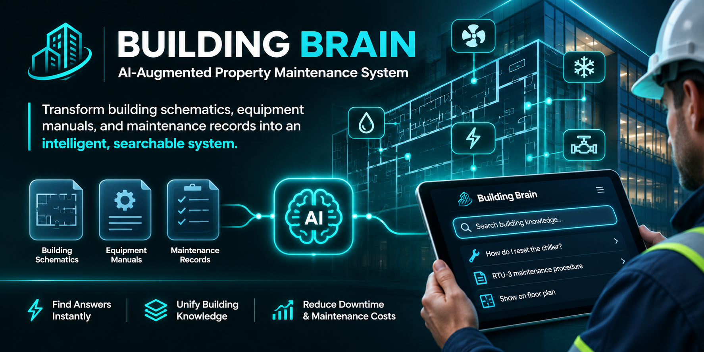

# Building Brain — AI-Augmented Property Maintenance MVP



**An actual working first release** of the property-specific maintenance knowledge system described in the invention summary and Q1 product roadmap. Source-grounded answers are its default mode. Optional generative AI can synthesize answers from retrieved excerpts, with citations and explicit safety warnings.

> **Private project.** Proprietary source code. Do not publish repository contents or upload confidential building drawings to public services without permission.

## What's working

| Capability | Implementation |
| --- | --- |
| Property / building registry | Create multiple properties and buildings, maintain strict property-scoped queries |
| Building templates | Building B can inherit reference docs/assets from Building A within the same property; inherited results are labeled |
| Document upload | Indexed PDF (selectable text), DOCX, TXT, MD, CSV, 20 MB each; original documents retained for reference |
| Document Q&A | SQLite FTS5 retrieval, source excerpts, filename + PDF page citations, missing-info feedback |
| Optional AI synthesis | Set `AI_PROVIDER=ollama` or `AI_PROVIDER=openai` (OFF by default) |
| Equipment registry | Search equipment names, locations, system, model, serial, warranty notes |
| **FacilityGuard** | Integrated work orders, recurring preventive maintenance, inspections with corrective follow-ups, property dashboard and CSV export at `/facilityguard` |
| Field notes | New notes start `pending`, become searchable only after review/approval |
| Building exceptions | Approved building-specific deviations rank ahead of inherited templates |
| Mobile-friendly interface | Responsive, browser-based dashboard; no frontend compilation |
| Basic authentication | Required password on every route except health check, intended for one trusted organization |
| Deployment | Docker Compose, SQLite persistent named volume, loopback-only binding on port `8124` |

**Not yet built:** OCR for scans, native DWG/Revit/IFC parsing, actual diagram/topology interpretation, mobile camera overlays, photo uploads, technician role/permission separation, CMMS integration, parts recognition, sensor feeds, SSO, SOC 2 controls, source versioning, automatic field verification, and offline mobile caching. An inherited building template is **not proof of a specific building's installed configuration**.

## FacilityGuard operations module

Open **FacilityGuard** from the Building Brain navigation (or `/facilityguard`). Work orders, recurring PM schedules and inspection records share the existing property/building/equipment registry. A failed inspection can create a corrective work order. Due work, overdue counts, inspection findings, and a property-level CSV report are included. The existing SQLite database is upgraded with additive tables on application startup; **back up the persistent database before deploying**. See [FACILITYGUARD.md](FACILITYGUARD.md) for endpoints, limitations and deployment guidance. This remains a single-organization MVP, not a regulatory compliance certification or audited commercial CMMS.

## Run it on your Ubuntu server (Docker Compose)

Unzip the release into `~/building-brain-mvp`, then:

```bash
cd ~/building-brain-mvp
bash scripts/setup.sh
docker compose up -d --build
docker compose ps
```

`setup.sh` creates a private `.env` and displays the login username/password. If you lose the password, retrieve it securely from `.env`; do not paste it into chats or source control. The application refuses to start with the example placeholder password.

### Open it from your Fedora desktop

The Compose port is intentionally bound to **127.0.0.1 on the server**, not the public internet. From your desktop, open an SSH tunnel:

```bash
ssh -L 8124:127.0.0.1:8124 yeet
```

Leave the SSH window connected. In your desktop browser open **http://localhost:8124**. Sign in using the credentials from `scripts/setup.sh`. If `yeet` is not a resolvable SSH hostname, use its actual SSH host/IP.

For public production access, use an HTTPS reverse proxy plus stronger authentication/SSO, role access, backups and security review. Do not put live building drawings behind unaudited public endpoints.

## Get started

1. Open **Buildings & templates** → create a property → add Building A.
2. Open **Documents** → upload actual authorized reference files; choose whether the file applies to all buildings or a specific building.
3. Open **Ask Building Brain** → ask a question. The tool lists source passages with filenames, scope, and PDF page numbers. It **does not invent** an answer when information is absent.
4. Open **Equipment registry** → add real equipment metadata to make it searchable.
5. Open **Field notes** → submit a technician observation; approve it to index the record.
6. To reuse a layout, add Building B with Building A selected as its template. Record and approve exceptions for any deviations.

### Optional synthetic demo dataset

For a **fresh empty database only**:

```bash
docker compose exec web python scripts/seed_demo.py
```

Reload the app. The dataset creates *fictional* Harborview Apartments, Building A and Building B, sample reference records and one approved layout exception. Everything is labeled DEMO. It never inserts records into an existing nonempty database and **must never be used for real maintenance**.

Try: "Where is the main water isolation valve?" and "What do we know about RTU-A3?" Select Building B to see inherited template references and the exception.

## Enable optional AI-generated synthesis

Search-only mode works with **no model, no API key, and no internet access**. It extracts relevant source passages but is not generative AI. To enable generative synthesis, edit `.env` and then run `docker compose up -d --force-recreate`:

- **Ollama on the Docker host:** Set `AI_PROVIDER=ollama`, `OLLAMA_MODEL` to a model you have actually installed, and `OLLAMA_BASE_URL=http://host.docker.internal:11434`. Docker's host-gateway mapping is included, but your Ollama service must listen on an address reachable from the container. On an 8 GB server, local inference may be limited and slow.
- **OpenAI API:** Set `AI_PROVIDER=openai`, `OPENAI_MODEL` to a model supported by your account, and `OPENAI_API_KEY` to your key. **This sends retrieved property text passages to the external API**. Enable this only if the property owner's data policy allows it.

When synthesis fails, the system falls back to source passages. Models can still generate mistakes: verify against the original drawings and approved procedures before acting.

## Security / operational limits

- This is an **MVP**, not production-grade multi-tenant SaaS. One Basic Auth credential grants admin-level access to all properties in this deployment. Property scoping prevents accidental cross-property retrieval but is **not independent customer authorization**. Do not serve different customers from this instance.
- Use SSH tunneling or a correctly configured HTTPS reverse proxy. Basic Auth should never be used over plain public HTTP.
- Sensitive documents, equipment locations and work orders belong only on an approved server. Original uploads and extracted passages are kept in the persistent Docker volume, not sent anywhere unless AI is enabled.
- File type is selected by extension; there is not yet enterprise-grade malware scanning or content-type validation. Only allow trusted uploads.
- Approved notes and exceptions reflect a reviewer action, not independent physical verification. The reviewer should verify before approval.
- Life-safety, LOTO, gas, electrical, water isolation and pressure-system operations require current field inspection, qualified personnel and approved site procedures. Never perform risky operations from an AI answer alone.
- Back up the Docker named volume `building_brain_data` (SQLite DB + original files), preferably with the app stopped during a raw volume snapshot. Test restore procedures. The application does not provide automated backups.
- Reverse proxy configuration depends on whether your existing Caddy is on the host or in another container; don't blindly copy a `127.0.0.1` upstream into a Caddy container.

## Dev / tests

```bash
python3 -m venv .venv
source .venv/bin/activate
pip install -r requirements-dev.txt
pytest -q
# To run outside Docker:
mkdir -p appdata
APP_PASSWORD='a-unique-secret-password' DATA_DIR=./appdata uvicorn app.main:app --port 8124
```

REST endpoints include `/api/overview`, `/api/properties`, `/api/buildings`, `/api/documents`, `/api/documents/upload`, `/api/documents/{id}/file`, `/api/assets`, `/api/notes`, `/api/exceptions`, and `/api/ask`.

## Scope / next release

Based on the **original Q1 roadmap**: ingestion (PDF/CAD *exports*), indexed properties and assets, property-restricted source-backed Q&A, mobile-friendly interface. Q2 is partly prototyped (feedback approvals, template links and exceptions); actual CMMS integration and advanced emergency workflows remain future work.

Suggested next milestone: real OCR + plan/asset location linking; immutable source revisions and review provenance; role-based technician/supervisor access; property-specific incident audit trail; integration of actual building topology and asset relationships; formal security validation. A small paid pilot should begin with non-critical records before safety-sensitive procedures.
